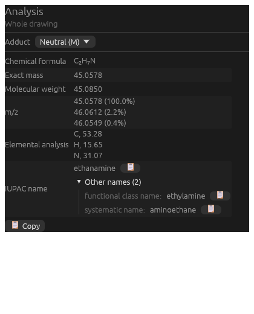

<div align="center">


# Open DrawChemistry

**Draw chemical structures. Open your ChemDraw files. Name, analyse and build in 3D. Free and open source.**

[](https://indigocarmine.github.io/open_draw_chemistry-site/en/)
[](https://github.com/IndigoCarmine/open_draw_chemistry/actions/workflows/ci.yml)
[](https://github.com/IndigoCarmine/open_draw_chemistry/releases/latest)
[](LICENSE)


**[🌐 Website](https://indigocarmine.github.io/open_draw_chemistry-site/en/)** · [日本語](README_ja.md) · [Download](https://github.com/IndigoCarmine/open_draw_chemistry/releases/latest) · [Development guide](docs/DEVELOPMENT.md)

</div>

---

Open DrawChemistry is a desktop app for drawing chemical structures and reaction schemes,
in the spirit of ChemDraw, ChemSketch and XDrawChem. It **reads and writes ChemDraw files
(`.cdx` / `.cdxml`)**, gives each structure an **IUPAC name**, works out formula and mass on
the fly, and turns a 2D drawing into a **3D model** you can optimise and assemble into larger
structures. It is written in Rust with [egui](https://github.com/emilk/egui) and runs on
Windows, macOS and Linux.

> 🌐 **New here?** The [website](https://indigocarmine.github.io/open_draw_chemistry-site/en/) has a guided tour of the features, downloads and the user docs.

<div align="center">

<br><sub>The analysis panel: formula, exact mass, isotope pattern, elemental analysis, the IUPAC name, and other names.</sub>
</div>

## ✨ Highlights

| | |
|---|---|
| ✏️ **Draw** | Bonds of every style (wedge, hash, bold, wavy, dative…), element picker, ChemDraw-style right-click menus, fragments, 2D clean-up, undo/redo. Fonts, colours, ring fills and shadows. |
| 📂 **ChemDraw-compatible** | Open and save `.cdx` / `.cdxml`. Objects the editor can't show yet are kept when you save. |
| 🏷️ **IUPAC names** | Preferred IUPAC names (2013 recommendations), including E/Z and R/S, rings, spiro and bicyclic systems, and inorganic salts. Alternatives are listed too: functional-class, retained and other systematic names. Copy a name or put it on the page. |
| 🔬 **Analysis** | Formula, exact mass and molecular weight, isotope pattern (m/z) and elemental analysis, updated as you draw. |
| 🧊 **3D** | Generate a 3D model with OpenBabel, which respects wedges and expands Ph / OMe. Optimise it with MMFF94, UFF or GAFF, view and edit it in 3D, and export MOL, SDF, XYZ or PDB. |
| 🧩 **Assemblies and scans** | Build rings, stacks, helices and crystal lattices from monomers. Check clashes, and measure distances and angles. Run multi-dimensional energy scans, rigid or relaxed. |
| 📝 **Office integration** (Windows) | Edit ChemDraw objects in Word and PowerPoint on a PC without ChemDraw. Copy puts a ChemDraw-compatible structure and a picture on the clipboard. |
| 🌐 **11 languages** | English, 日本語, 简体中文, 繁體中文, 한국어, Deutsch, Français, Español, Italiano, Português (Brasil), Русский. |

## 🚀 Get started

**Download** the installer or portable package for your platform from the
[website](https://indigocarmine.github.io/open_draw_chemistry-site/en/) or the [latest release](https://github.com/IndigoCarmine/open_draw_chemistry/releases/latest). OpenBabel is bundled, so there is nothing else to install.

> macOS: the app isn't notarised yet, so the first time, right-click it and choose **Open**.
> Windows: the installer isn't signed yet, so SmartScreen may warn you.

**Build from source** (Rust 1.95+):

```bash
bash scripts/fetch-openbabel.sh   # one-time: fetch the prebuilt OpenBabel
cargo run -- path/to/file.cdx     # the file is optional
```

Platform notes, packaging, releases and CI are in the **[development guide](docs/DEVELOPMENT.md)**.

## 📝 ChemDraw objects in Word / PowerPoint (Windows)

On a PC **without ChemDraw**, double-click a ChemDraw structure in a Word or PowerPoint
document and it opens here in its own tab. Save (Ctrl+S) or close the tab, and the structure
and its picture are written back. The object stays a ChemDraw object, so ChemDraw can still
open it on another PC.

The installer sets this up for the current user, with no admin rights needed. Where ChemDraw is installed,
none of its settings are touched. To set it up by hand:

```sh
open_draw_chemistry.exe --register-ole     # register
open_draw_chemistry.exe --unregister-ole   # remove exactly what was registered
```

## 🧱 Built on

- [chembuider-rs](https://github.com/IndigoCarmine/chembuider-rs): the structure editor widget, the IUPAC namer and the analysis panel
- [cdx_file_rs](https://github.com/IndigoCarmine/cdx_file_rs): ChemDraw file codecs
- [openbabel_rs](https://github.com/IndigoCarmine/openbabel_rs): Rust bindings to [OpenBabel](https://openbabel.org), used for 3D generation, force fields and SMILES
- [egui](https://github.com/emilk/egui): the UI

## 📄 License

GPL-2.0-or-later. See [LICENSE](LICENSE). The app is GPL because it links OpenBabel.
