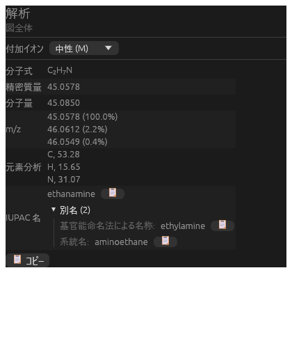

<div align="center">


# Open DrawChemistry

**構造式を描く。ChemDraw のファイルを開く。名前をつけ、解析し、3D で組み立てる。無料のオープンソース。**

[](https://github.com/IndigoCarmine/open_draw_chemistry/actions/workflows/ci.yml)
[](https://github.com/IndigoCarmine/open_draw_chemistry/releases/latest)
[](LICENSE)


[English](README.md) · [ダウンロード](https://github.com/IndigoCarmine/open_draw_chemistry/releases/latest) · [開発ガイド](docs/DEVELOPMENT_ja.md)

</div>

---

Open DrawChemistry は、ChemDraw・ChemSketch・XDrawChem のように化学構造式や反応式を描くための
デスクトップアプリです。

- **ChemDraw のファイル（`.cdx` / `.cdxml`）をそのまま読み書き**できます。
- 構造式に **IUPAC 名**をつけ、分子式や質量をその場で計算します。
- 2D の図から **3D モデル**を作り、最適化したり、大きな集合体に組み立てたりできます。

Rust と [egui](https://github.com/emilk/egui) で作られており、Windows・macOS・Linux で動きます。

<div align="center">

<br><sub>解析パネル：分子式、精密質量、同位体パターン、元素分析、IUPAC 名と別名。</sub>
</div>

## ✨ できること

| | |
|---|---|
| ✏️ **作図** | くさび・破線・太線・波線・配位などあらゆる結合、元素の選択、ChemDraw 風の右クリックメニュー、フラグメント、2D クリーンアップ、元に戻す／やり直し。フォント・色・環の塗りつぶし・影も設定できます。 |
| 📂 **ChemDraw 互換** | `.cdx` / `.cdxml` を開いて保存。まだ表示できないオブジェクトも、保存時にそのまま残ります。 |
| 🏷️ **IUPAC 名** | IUPAC 2013 勧告の優先名に対応しています。E/Z・R/S、環・スピロ・二環、無機塩も扱えます。基官能名・慣用名などの別名も一覧でき、名前はコピーしたり図に書き込んだりできます。 |
| 🔬 **解析** | 分子式、精密質量・分子量、同位体パターン（m/z）、元素分析を、描いたそばから表示します。 |
| 🧊 **3D** | OpenBabel で 3D モデルを生成します（くさびの立体を反映し、Ph / OMe などの略号を展開）。MMFF94・UFF・GAFF で最適化し、3D で表示・編集して、MOL / SDF / XYZ / PDB に書き出せます。 |
| 🧩 **集合体とスキャン** | モノマーから環・積層・らせん・結晶格子を組み立てます。原子の衝突を調べ、距離・角度を測れます。多次元のエネルギースキャンは rigid と relaxed の両方に対応しています。 |
| 📝 **Office 連携**（Windows） | ChemDraw がない PC でも、Word・PowerPoint に埋め込まれた ChemDraw オブジェクトを編集できます。コピーすると、ChemDraw 互換の構造と図がクリップボードに入ります。 |
| 🌐 **11 言語** | 日本語、English、简体中文、繁體中文、한국어、Deutsch、Français、Español、Italiano、Português (Brasil)、Русский。 |

## 🚀 はじめる

**ダウンロード**：[最新リリース](https://github.com/IndigoCarmine/open_draw_chemistry/releases/latest)から、お使いの OS 用のインストーラかポータブル版を入手してください。OpenBabel を同梱しているので、ほかに入れるものはありません。

> macOS：まだ公証を受けていないので、初回は右クリック →「開く」で起動してください。
> Windows：インストーラがまだ署名されていないので、SmartScreen の警告が出ることがあります。

**ソースからビルド**（Rust 1.95 以上）：

```bash
bash scripts/fetch-openbabel.sh   # 最初に一度：ビルド済みの OpenBabel を取得
cargo run -- path/to/file.cdx     # ファイルの指定は省略可
```

OS ごとの注意、パッケージの作り方、リリース、CI については **[開発ガイド](docs/DEVELOPMENT_ja.md)** を参照してください。

## 📝 Word / PowerPoint の ChemDraw オブジェクト（Windows）

**ChemDraw が入っていない PC** でも、Word や PowerPoint の文書の ChemDraw 構造式をダブルクリックすると、
このアプリのタブで開きます。保存（Ctrl+S）するかタブを閉じると、構造式と表示用の図が文書に書き戻されます。
オブジェクトは ChemDraw のオブジェクトのままなので、ChemDraw がある PC ではそのまま ChemDraw で開けます。

設定はインストーラが現在のユーザーに対して行います（管理者権限は不要）。ChemDraw がある PC では、ChemDraw の設定は一切変更しません。手動で行う場合：

```sh
open_draw_chemistry.exe --register-ole     # 登録
open_draw_chemistry.exe --unregister-ole   # 登録したものだけを削除
```

## 🧱 使っているもの

- [chembuider-rs](https://github.com/IndigoCarmine/chembuider-rs)：構造式エディタのウィジェット、IUPAC 命名、解析パネル
- [cdx_file_rs](https://github.com/IndigoCarmine/cdx_file_rs)：ChemDraw ファイルの読み書き
- [openbabel_rs](https://github.com/IndigoCarmine/openbabel_rs)：[OpenBabel](https://openbabel.org) の Rust バインディング（3D 生成、力場、SMILES）
- [egui](https://github.com/emilk/egui)：UI

## 📄 ライセンス

GPL-2.0-or-later です。[LICENSE](LICENSE) を参照してください。OpenBabel をリンクしているため GPL になっています。
